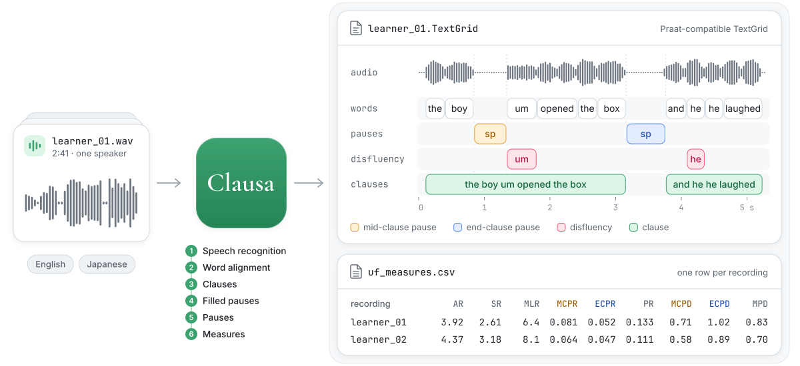

# Clausa

[English](README.md) · 日本語 · [简体中文](README.zh-CN.md)

Clausaは、utterance fluency研究のアノテーション作業を自動で行います。発話の録音を入力すると、アノテーション（words、pauses、disfluencies、clauses）をTextGridファイルとして出力します。英語と日本語に対応し、第二言語と第一言語のどちらの発話にも使えます。

<picture>
  <source media="(prefers-color-scheme: dark)" srcset="docs/images/overview-dark.svg">
  
</picture>

名前は、*clause*と、pauseを意味するラテン語*pausa*に由来します。

## ダウンロード

- Mac: [Clausa-1.0.2-macos-arm64.zip](https://github.com/0ldriku/Clausa/releases/download/v1.0.2/Clausa-1.0.2-macos-arm64.zip)
- Windows: [Clausa-1.0.2-windows-x64.zip](https://github.com/0ldriku/Clausa/releases/download/v1.0.2/Clausa-1.0.2-windows-x64.zip)
- Linux: [コマンドライン](docs/command-line.md)（英語）

## 動作環境

| | Mac | Windows |
|---|---|---|
| システム | Appleシリコン搭載のMac、macOS 14以降 | 64ビット版Windows 11、またはMicrosoft EdgeがインストールされたWindows 10 |
| GPU | 内蔵 | メモリ8GB以上のNVIDIA製（任意）。ない場合は約3倍の時間がかかります |
| メモリ | 16GB以上 | 16GB以上。NVIDIA製GPUがない場合は32GB |
| 空き容量 | 20GB | 30GB |
| インターネット | 初回起動時に8.3GBをダウンロード | 初回起動時に11.8GBをダウンロード |

処理はすべてお使いのコンピューター上で行われ、Clausaは何も収集・送信しません。インターネットを使うのは、初回起動時にモデルをダウンロードするときだけです。

## セットアップ

**Mac**

1. ダウンロードしたzipを展開し、`Clausa`フォルダーをホームフォルダーに移動します。
2. **First start**をダブルクリックします。macOSによってブロックされた場合は、システム設定 › プライバシーとセキュリティを開き、**このまま開く**をクリックします。
3. ウィンドウにReadyと表示されるまで待ち、**Open Clausa**をクリックします。

次回以降は**Clausa.app**を開いてください。

**Windows**

1. zipを右クリックし、**すべて展開**を選びます。
2. `Clausa`フォルダーの**Clausa.exe**をダブルクリックします。「Windows によって PC が保護されました」と表示されたら、**詳細情報**をクリックし、次に**実行**をクリックします。
3. ウィンドウにReadyと表示されるまで待ち、**Open Clausa**をクリックします。

次回以降は**Clausa.exe**を開いてください。

`Clausa`フォルダーは、iCloud Drive、OneDrive、Dropboxの中に置かないでください。セットアップが途中で止まった場合は、もう一度実行してください。止まったところから再開します。

## 使い方

1. **新規プロジェクト**をクリックします。名前を付け、英語か日本語を選びます。
2. **録音を追加**をクリックするか、音声ファイル（WAV、MP3、FLAC、OGG、M4A）をウィンドウにドラッグします。
3. **開始**をクリックします。
4. 分析が終わったら、**CSVを開く**をクリックすると指標を確認できます。

プロジェクトは「書類」フォルダー（Windowsでは「ドキュメント」）の`Clausa projects`に保存されます。保存先は**設定** › **フォルダーを変更…**で変更できます。

## 指標

| 指標 | 意味 |
|---|---|
| AR | 発話時間1秒あたりのsyllable数 |
| SR | pauseを含めた1秒あたりのsyllable数 |
| MLR | pauseとpauseの間のsyllable数 |
| MCPR | clause内のpauseの数（syllableあたり） |
| ECPR | clause末のpauseの数（syllableあたり） |
| PR | すべてのpauseの数（syllableあたり） |
| MCPD | clause内のpauseの平均長（秒） |
| ECPD | clause末のpauseの平均長（秒） |
| MPD | すべてのpauseの平均長（秒） |

[計算方法](docs/measures.md)（英語）。

## 精度

Clausaには、論文の時点から改良が加えられています。[詳細](docs/improvements.md)（英語）。

論文の結果を正確に再現するには、[論文の再現](docs/reproducing-the-paper.md)（英語）を参照してください。

## 制限事項

Clausaの結果は自動的に生成されたものであり、誤りを含む可能性があります。結果を報告する前に、たとえばアノテーションファイルをPraatで開いて確認してください。報告する結果についての責任は利用者が負います。

日本語では、数字で書かれた数は1桁ずつ読まれます。たとえば25（にじゅうご、4 morae）は2 moraeと数えられます。数を含む録音では、moraを使う指標がこの影響を受けます。

## 速度

手元の3台のコンピューターで計測しました。録音1件は2〜3分の音声ファイルです。録音10件は49秒〜4分の音声ファイルで、合計約20分です。

| コンピューター | 録音1件 | 録音10件 |
|---|---|---|
| Mac: M1 Max、64GB | 1分 | 3分 |
| Windows: Ryzen 5 3600、32GB、RTX 4060 Ti 8GB | 1.5分 | 5分 |
| Windows、GPUなし | 4.5分 | |
| Linux: Ryzen 9 9950X、128GB、RTX 5090、コマンドライン | 35秒 | 1.5分 |

## よくある質問

**Clausaは何を出力しますか？**
主な出力は録音ごとのTextGridファイルで、各単語、pause、disfluency、clauseの開始時刻と終了時刻が入っています。Clausaの標準の計算機能は、これをもとに9つの[指標](#指標)を算出し、`uf_measures.csv`に書き出します。それ以外の指標は、各セッションの`clauses`フォルダーにあるTextGridファイルから計算してください。

**録音は事前に処理しておく必要がありますか？**
- 分析したい部分だけを切り出してください。指標は最初の単語から最後の単語までを対象とするため、冒頭と末尾の無音は計算に含まれません。
- 音量の正規化は不要です。録音時に音割れしないようにしてください。
- ノイズ除去は通常不要です。強いノイズ除去をかけると、小さな声やfilled pauseまで消え、pauseの指標が変わることがあります。使う場合は、すべての録音を同じ設定で処理してください。

**会話やインタビューも分析できますか？**
はい。Clausaは録音内のすべての発話を書き起こし、アノテーションを付けます。ただし、話者の区別にはまだ対応していません（話者分離は今後対応予定です）。話者が複数いる場合、指標には全員の発話が混ざるため、TextGridファイルを使ってください。

**何がpauseとして扱われますか？**
単語間の0.25秒以上の無音です。

**TextGridを修正した後、指標を再計算できますか？**
現在はできません。指標の計算は、今後のバージョンで独立したステップにする予定です。

**別のコンピューターで結果が異なるのはなぜですか？**
コンピューターが異なると、書き起こしがわずかに異なることがあります。同じ研究の録音は、すべて同じコンピューターで分析してください。

## 対応言語

Clausaは英語と日本語に対応しています。設計はこの2言語に限ったものではありませんが、各ステップにはこの2言語向けに書かれた部分があります。新しい言語には、その言語に対応した音声認識器とアライナー、その言語用に書いたclauseの規則、syllableの数え方が必要です。最初のステップ以降はすべて書き起こしに基づくため、学習者の発話に対する認識器の精度が最も重要です。Disfluency検出器の拡張はさらに難しく、英語と日本語のみで学習されています。

Clause分割を新しい言語に適用しやすくする予定です。

## 困ったときは

Clausaの動作は、手元の数台のコンピューターでしか確認していません。お使いのコンピューターで動作しない場合や、その他の問題が起きた場合は、[GitHub](https://github.com/0ldriku/Clausa/issues)でissueを作成するか、oldriku@proton.meまでメールでお知らせください。その際、`Clausa`フォルダー内の`logs`フォルダーを添付してください。ログには録音から認識された単語が含まれるため、共有に問題がない場合のみ送ってください。

## 開発者向け

- [コマンドライン](docs/command-line.md)（英語）
- [論文の再現](docs/reproducing-the-paper.md)（英語）
- [開発者ガイド](docs/development.md)（英語）

## ライセンス

コードはMITライセンスです。Clausaのdisfluency検出器（[oldriku/Clausa](https://huggingface.co/oldriku/Clausa)）はCC BY-NC-SA 4.0で、非営利利用に限ります。[LICENSE.md](LICENSE.md)を参照してください。

## 引用

Clausaを使用した場合は、次の論文を引用してください。論文は印刷中のため、年、巻、ページ、DOIは出版後に追記します。

> Lu, J., & Sato, R. (in press). Automatic cross-lingual annotation of
> clause-based utterance fluency in L2 speech. *Research Methods in Applied
> Linguistics*.

```bibtex
@article{lu_sato_clausa,
  author  = {Lu, Jialiang and Sato, Reiko},
  title   = {Automatic cross-lingual annotation of clause-based utterance fluency in {L2} speech},
  journal = {Research Methods in Applied Linguistics},
  year    = {in press}
}
```
