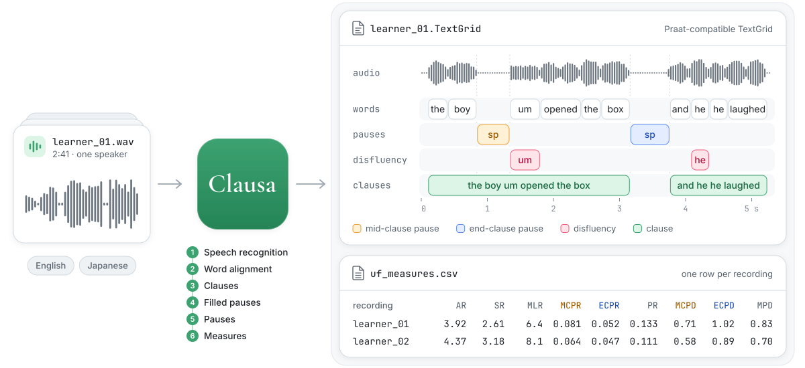

# Clausa

[English](README.md) · 日本語 · [简体中文](README.zh-CN.md)

Clausaは、発話データの流暢性アノテーション作業を自動で行います。発話の録音を入力すると、アノテーション（words、pauses、disfluencies、clauses）をTextGridファイルとして出力します。今は英語と日本語に対応しています。

<picture>
  <source media="(prefers-color-scheme: dark)" srcset="docs/images/overview-dark.svg">
  
</picture>

名前は、*clause*と、pauseを意味するラテン語*pausa*に由来します。

## ダウンロード

- Mac: [Clausa-1.0.4-macos-arm64.zip](https://github.com/0ldriku/Clausa/releases/download/v1.0.4/Clausa-1.0.4-macos-arm64.zip)
- Windows: [Clausa-1.0.4-windows-x64.zip](https://github.com/0ldriku/Clausa/releases/download/v1.0.4/Clausa-1.0.4-windows-x64.zip)
- Linux: [コマンドライン](docs/command-line.md)（英語）

[各バージョンの変更点](CHANGELOG.md)（英語）

## 動作環境

| | Mac | Windows |
|---|---|---|
| システム | Appleシリコン搭載のMac、macOS 14以降 | 64ビット版Windows 11、またはMicrosoft EdgeがインストールされたWindows 10 |
| GPU | 内蔵 | メモリ8GB以上のNVIDIA製（任意）。ない場合は約3倍の時間がかかります |
| メモリ | 16GB以上 | 16GB以上。NVIDIA製GPUがない場合は32GB |
| 空き容量 | 20GB | 30GB |
| インターネット | 初回起動時に8.3GBをダウンロード | 初回起動時に11.8GBをダウンロード |

## セットアップ

**Mac**

1. ダウンロードしたzipを展開し、`Clausa`フォルダーをホームフォルダーに移動します。
2. **First start**をダブルクリックします。macOSによってブロックされた場合は、システム設定 › プライバシーとセキュリティを開き、**このまま開く**をクリックします。
3. ウィンドウにReadyと表示されるまで待ち、**Open Clausa**をクリックします。

次回以降は**Clausa.app**を開いてください。

**Windows**

1. zipを右クリックし、**すべて展開**を選びます。
2. `Clausa`フォルダーの**Clausa.exe**をダブルクリックします。「Windows によって PC が保護されました」と表示されたら、**詳細情報**をクリックし、次に**実行**をクリックします。
3. ウィンドウにReadyと表示されるまで待ち、**Open Clausa**をクリックします。

次回以降は**Clausa.exe**を開いてください。

## 使い方

1. **新規プロジェクト**をクリックします。名前を付け、英語か日本語を選びます。
2. **アノテーション**で**録音を追加**をクリックするか、音声ファイル（WAV、MP3、FLAC、OGG、M4A）をウィンドウにドラッグし、**開始**をクリックします。
3. TextGridをPraatで確認し、修正します。録音の行にあるフォルダーボタンでセッションフォルダーが開きます。TextGridは`clauses`にあります。
4. **計算**で**開始**をクリックします。**CSVを表示 › 指標**で、`uf_measures.csv`をフォルダーで表示します。

プロジェクトは「書類」フォルダー（Windowsでは「ドキュメント」）の`Clausa projects`に保存されます。保存先は**設定** › **フォルダーを変更…**で変更できます。

## 指標

指標は、英語ではsyllable単位、日本語ではmora単位で計算します。

| 指標 | 意味 |
|---|---|
| AR | 発話時間1秒あたりのsyllable/mora数 |
| SR | pauseを含めた1秒あたりのsyllable/mora数 |
| MLR | pauseとpauseの間のsyllable/mora数 |
| MCPR | clause内のpauseの数（syllable/moraあたり） |
| ECPR | clause末のpauseの数（syllable/moraあたり） |
| PR | すべてのpauseの数（syllable/moraあたり） |
| MCPD | clause内のpauseの平均長（秒） |
| ECPD | clause末のpauseの平均長（秒） |
| MPD | すべてのpauseの平均長（秒） |

[計算方法](docs/measures.md)（英語）。

## 精度

Clausaには、論文の時点から改良が加えられています。[詳細](docs/improvements.md)（英語）。

論文の結果を正確に再現するには、[論文の再現](docs/reproducing-the-paper.md)（英語）を参照してください。

## 制限事項

Clausaの結果は自動的に生成されたものであり、誤りを含む可能性があります。結果を報告する前に、たとえばアノテーションファイルをPraatで開いて確認してください。報告する結果についての責任は利用者が負います。

## 速度

手元の3台のコンピューターで計測しました。録音1件は2〜3分の音声ファイルです。録音10件は49秒〜4分の音声ファイルで、合計約20分です。

| コンピューター | 録音1件 | 録音10件 |
|---|---|---|
| Mac: M1 Max、64GB | 1分 | 3分 |
| Windows: Ryzen 5 3600、32GB、RTX 4060 Ti 8GB | 1.5分 | 5分 |
| Windows、GPUなし | 4.5分 | |
| Linux: Ryzen 9 9950X、128GB、RTX 5090、コマンドライン | 35秒 | 1.5分 |

## よくある質問

### Clausaは何を出力しますか？

録音ごとのTextGridファイルです。各単語、pause、disfluency、clauseの開始時刻と終了時刻が入っています。これが主な出力です。

**計算**では、TextGridから9つの[指標](#指標)を算出して`uf_measures.csv`に書き出し、指標の元になった単語、pause、clauseを`uf_words.csv`、`uf_pauses.csv`、`uf_clauses.csv`に書き出します（[各列の説明](docs/measures.md#tables)）。それ以外の指標は、これらの表か、各セッションの`clauses`フォルダーにあるTextGridファイルから計算してください。

### 会話やインタビューも分析できますか？

はい。Clausaはすべての発話を書き起こし、アノテーションを付けます。ただし、話者は区別しません。話者が複数いる場合は指標に全員の発話が混ざるため、1人だけが話している範囲を分析するか（[録音の一部](#録音の一部だけを分析できますか)）、TextGridファイルを使ってください。話者分離は実装が難しいため、別のプロジェクトで対応するかもしれません。

### pauseの定義は？

単語間の0.25秒以上の無音です。

### clauseの定義は？

Vercellotti and Hall（2024、[doi:10.1016/j.rmal.2024.100132](https://doi.org/10.1016/j.rmal.2024.100132)）の定義に従い、動詞と要素からなるまとまりをclauseとします。定形のclause、それぞれ補語や付加語を持つ等位の動詞、明示的な要素を持つ非定形のclause、コピュラのない述語が含まれます。日本語では、「から」「けど」「ので」などの接続助詞を伴う述語が1つのclauseになり、clauseは接続助詞で終わります。テ形の動詞は、独自の補語や付加語を持つ場合にだけclauseになります。両言語の規則は論文にあります（[引用](#引用)）。

### disfluencyの定義は？

Clausaのdisfluency検出器が印を付けた語です。filled pause（um、えっと）、repetition、self-correction、false start、partial wordが対象で、日本語ではparticle correctionと語の読みのfalse startも含みます。それぞれがどの種類かは示しません。限界は次のとおりです。

- 英語の会話（Switchboard）と、書き言葉から規則で作った学習者の合成文（Kundu et al., 2022の方法）で学習しています（[学習コード](training/disfluency_detector/)）。
- 実際の第二言語の発話では検証されていません。英語母語話者の発話（DisfluencySpeech）では、disfluentな語の62%を検出し、印を付けた語の88%が実際にdisfluentでした（F1 .73）。日本語は合成文でのみ検証しています。
- 合成文は、日本語を母語とする英語学習者と、英語を母語とする日本語学習者を想定しています。ほかの母語では結果が異なる可能性があります。

Praatでdisfluency tierを確認してください。詳細と文献は[モデルカード](https://huggingface.co/oldriku/Clausa)（英語）にあります。

### 各ステップで使っているモデルとソフトウェアは？

| ステップ | モデル・手法 | ソフトウェア |
|---|---|---|
| 音声認識 | Qwen3-ASR-1.7B。単語のおおよその時刻はQwen3-ForcedAligner-0.6B（Shi et al., 2026） | qwen-asrとPyTorch（Paszke et al., 2019）。MacではMLX（Hannun et al., 2023）上のmlx-qwen3-asr |
| 単語の時刻 | MFAの英語（US ARPA）・日本語モデル3.0.0。日本語の単語分割はMeCab（Kudo et al., 2004）とUniDic-lite | Montreal Forced Aligner 3.3.9（McAuliffe et al., 2017）、fugashi（McCann, 2020） |
| pause | アラインメント後の単語間にある0.25秒以上の無音 | — |
| disfluency | [Clausaのdisfluency検出器](https://huggingface.co/oldriku/Clausa)：XLM-RoBERTa-base（Conneau et al., 2020）を、Switchboard（Godfrey et al., 1992）と学習者の合成文（Kundu et al., 2022）でファインチューニング | Transformers（Wolf et al., 2020） |
| clause（英語） | Vercellotti and Hall（2024）に基づく規則。構文解析は`en_ud_L1L2e_combined_trf`（Kyle et al., 2022） | spaCy（Honnibal et al., 2020） |
| clause（日本語） | 同じ規則を日本語向けにしたもの。構文解析は`ja_ginza_electra` | GiNZA（Matsuda et al., 2019） |
| syllable（英語） | アラインメントされた発音の母音 | — |
| mora（日本語） | SudachiDict-coreによる各語のカナの読み | SudachiPy（Takaoka et al., 2018） |

<details>
<summary>文献</summary>

- Conneau, A., et al. (2020). Unsupervised cross-lingual representation learning at scale. *ACL 2020*, 8440–8451. https://doi.org/10.18653/v1/2020.acl-main.747
- Godfrey, J. J., Holliman, E. C., & McDaniel, J. (1992). SWITCHBOARD: Telephone speech corpus for research and development. *ICASSP-92*, 517–520. https://doi.org/10.1109/icassp.1992.225858
- Hannun, A., Digani, J., Katharopoulos, A., & Collobert, R. (2023). *MLX: Efficient and flexible machine learning on Apple silicon* [Computer software]. https://github.com/ml-explore/mlx
- Honnibal, M., Montani, I., Van Landeghem, S., & Boyd, A. (2020). *spaCy: Industrial-strength natural language processing in Python* [Computer software]. https://spacy.io
- Kudo, T., Yamamoto, K., & Matsumoto, Y. (2004). Applying conditional random fields to Japanese morphological analysis. *EMNLP 2004*, 230–237. https://aclanthology.org/W04-3230/
- Kundu, R., Jyothi, P., & Bhattacharyya, P. (2022). Zero-shot disfluency detection for Indian languages. *COLING 2022*, 4442–4454. https://aclanthology.org/2022.coling-1.392/
- Kyle, K., Eguchi, M., Miller, A., & Sither, T. (2022). A dependency treebank of spoken second language English. *BEA 2022*, 39–45. https://doi.org/10.18653/v1/2022.bea-1.7
- Matsuda, H., Omura, M., & Asahara, M. (2019). *GiNZA: Japanese NLP library* [Computer software]. https://github.com/megagonlabs/ginza
- McAuliffe, M., Socolof, M., Mihuc, S., Wagner, M., & Sonderegger, M. (2017). Montreal Forced Aligner: Trainable text-speech alignment using Kaldi. *Interspeech 2017*, 498–502. https://doi.org/10.21437/interspeech.2017-1386
- McCann, P. (2020). fugashi, a tool for tokenizing Japanese in Python. *NLP-OSS 2020*, 44–51. https://doi.org/10.18653/v1/2020.nlposs-1.7
- Paszke, A., et al. (2019). PyTorch: An imperative style, high-performance deep learning library. *NeurIPS 2019*, 8024–8035. https://arxiv.org/abs/1912.01703
- Shi, X., et al. (2026). *Qwen3-ASR technical report* (arXiv:2601.21337). https://doi.org/10.48550/arXiv.2601.21337
- Takaoka, K., Hisamoto, S., Kawahara, N., Sakamoto, M., Uchida, Y., & Matsumoto, Y. (2018). Sudachi: A Japanese tokenizer for business. *LREC 2018*. https://aclanthology.org/L18-1355/
- Vercellotti, M. L., & Hall, S. (2024). Coding all clauses in L2 data: A call for consistency. *Research Methods in Applied Linguistics*, *3*(3), 100132. https://doi.org/10.1016/j.rmal.2024.100132
- Wolf, T., et al. (2020). Transformers: State-of-the-art natural language processing. *EMNLP 2020: System Demonstrations*, 38–45. https://doi.org/10.18653/v1/2020.emnlp-demos.6

</details>

### どのような発話で検証されていますか？

第二言語学習者によるストーリーテリングのモノローグで、人手のアノテーションと比較しました（[精度](#精度)）。ALLSSTARの英語40録音（36人、14の母語）と、I-JASの日本語40録音（20人、4つの母語グループ）で、長さは19秒から6分です。それ以外の発話も処理できますが、検証はしていません（第一言語の発話、会話、子どもの発話、ほかのタスク、雑音の多い録音など）。指標を使う前に、ご自分の録音の一部をPraatで確認してください。

### 録音はどのくらいの長さまで扱えますか？

Apple siliconを搭載したMacでは、80分までの録音で検証し、問題なく動作しました。8 GBのNVIDIAグラフィックスカードを搭載したWindowsでは、約6分を超える録音は非常に遅くなります（10分の録音に20分以上かかりました）。6分未満に切り分けてください。Linuxと、より大きなグラフィックスカードでは、長い録音を検証していません。

### 録音の一部だけを分析できますか？

はい。**アノテーション**で新しい録音を選び、**分析する範囲**で**一部**を選びます。波形の両端をドラッグするか時刻を入力し、**範囲を再生**で確認します。範囲外の単語は、Clause TextGridと指標から除外されます（単語TextGridにはすべて残ります）。アノテーション後は範囲が固定されます。別の範囲を分析するには、録音をプロジェクトから削除して追加し直してください。同じ範囲を他の新規録音すべてに使うことも、録音ごとの範囲をCSV（`file_id,start,end`、秒単位）からプロジェクトの**···**メニューの**CSVから範囲を読み込む**で設定することもできます。コマンドラインでは`--window 12.5 140`、またはこのCSVを`--windows`で指定します（[コマンドライン](docs/command-line.md)、英語）。

### TextGridを修正した後、指標をもう一度計算するには？

Praatで、tierの名前を変えずに、同じ場所にテキストファイルとして保存します。そのうえで**計算**の**開始**をクリックします。変更していないTextGridからは、前と同じ指標が得られます。

コマンドラインでは`./clausa measures en <出力フォルダー>`です（[コマンドライン](docs/command-line.md)、英語）。

### 別のコンピューターで結果が異なるのはなぜですか？

コンピューターが異なると、書き起こしがわずかに異なることがあります。同じ研究の録音は、すべて同じコンピューターで分析してください。

### 英語だけ、または日本語だけをインストールできますか？

現在はできません。インストールされるものの大部分（音声認識、アラインメント、disfluency検出のモデルと、それを動かすソフトウェア）は両方の言語で使われます。一方の言語だけに使う部分は小さく、日本語が約1.6 GB、英語が約0.6 GBです。

### ClausaフォルダーをiCloud Drive、OneDrive、Dropboxに置けますか？

お勧めしません。初回起動後のフォルダーは10GBを超えます。同期には時間がかかり、同期サービスがClausaの必要とするファイルをコンピューターから削除することがあります。

### セットアップが途中で止まった場合は？

もう一度実行してください。止まったところから再開します。

### 録音やデータは外部に送信されますか？

いいえ。処理はすべてお使いのコンピューター上で行われ、Clausaは何も収集・送信しません。インターネットを使うのは、初回起動時にモデルをダウンロードするときだけです。

## 対応言語

Clausaは英語と日本語に対応しています。設計はこの2言語に限ったものではありませんが、各ステップにはこの2言語向けに書かれた部分があります。新しい言語には、その言語に対応した音声認識器とアライナー、その言語用に書いたclauseの規則、syllableの数え方が必要です。最初のステップ以降はすべて書き起こしに基づくため、学習者の発話に対する認識器の精度が最も重要です。Disfluency検出器の拡張はさらに難しく、英語と日本語のみで学習されています。

Clause分割を新しい言語に適用しやすくする予定です。

## 困ったときは

Clausaの動作は、手元の数台のコンピューターでしか確認していません。お使いのコンピューターで動作しない場合や、その他の問題が起きた場合は、[GitHub](https://github.com/0ldriku/Clausa/issues)でissueを作成するか、oldriku@proton.meまでメールでお知らせください。その際、`Clausa`フォルダー内の`logs`フォルダーを添付してください。ログには録音から認識された単語が含まれるため、共有に問題がない場合のみ送ってください。

## 開発者向け

- [コマンドライン](docs/command-line.md)（英語）
- [論文の再現](docs/reproducing-the-paper.md)（英語）
- [開発者ガイド](docs/development.md)（英語）

## ライセンス

コードはMITライセンスです。Clausaのdisfluency検出器（[oldriku/Clausa](https://huggingface.co/oldriku/Clausa)）はCC BY-NC-SA 4.0で、非営利利用に限ります。[LICENSE.md](LICENSE.md)を参照してください。

## 引用

Clausaを使用した場合は、次の論文を引用してください。論文は印刷中のため、年、巻、ページ、DOIは出版後に追記します。

> Lu, J., & Sato, R. (in press). Automatic cross-lingual annotation of
> clause-based utterance fluency in L2 speech. *Research Methods in Applied
> Linguistics*.

```bibtex
@article{lu_sato_clausa,
  author  = {Lu, Jialiang and Sato, Reiko},
  title   = {Automatic cross-lingual annotation of clause-based utterance fluency in {L2} speech},
  journal = {Research Methods in Applied Linguistics},
  year    = {in press}
}
```
