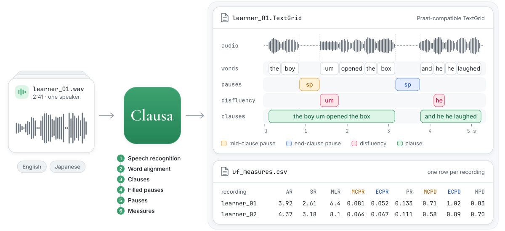

# Clausa

English · [日本語](README.ja.md) · [简体中文](README.zh-CN.md)

Clausa does the annotation work of utterance fluency research automatically.
Give it speech recordings and it returns the annotations as TextGrid files
(words, pauses, disfluencies, clauses). It works with English and Japanese,
for second- or first-language speech.

Clausa is a research tool with one purpose: annotating speech recordings as
accurately as possible, so that researchers can compute utterance fluency
measures from them.

<picture>
  <source media="(prefers-color-scheme: dark)" srcset="docs/images/overview-dark.svg">
  
</picture>

The name comes from *clause* and *pausa*, Latin for pause.

## Download

- Mac: [Clausa-1.0.4-macos-arm64.zip](https://github.com/0ldriku/Clausa/releases/download/v1.0.4/Clausa-1.0.4-macos-arm64.zip)
- Windows: [Clausa-1.0.4-windows-x64.zip](https://github.com/0ldriku/Clausa/releases/download/v1.0.4/Clausa-1.0.4-windows-x64.zip)
- Linux: the [command line](docs/command-line.md)

[What changed in each version](CHANGELOG.md)

## Requirements

| | Mac | Windows |
|---|---|---|
| System | Apple Silicon, macOS 14 or later | 64-bit Windows 11, or Windows 10 with Microsoft Edge |
| Graphics card | built in | NVIDIA with 8 GB or more; optional, without it about 3 times slower |
| Memory | 16 GB or more | 16 GB or more; 32 GB without an NVIDIA card |
| Free space | 20 GB | 30 GB |
| Internet | for the first start, which downloads 8.3 GB | for the first start, which downloads 11.8 GB |

Everything runs on your computer: Clausa collects nothing and sends nothing.
It uses the internet only to download the models at the first start.

## Set up

**Mac**

1. Unzip the download and move the `Clausa` folder to your home folder.
2. Double-click **First start**. If macOS blocks it, open System Settings ›
   Privacy & Security and click **Open Anyway**.
3. Wait until the window says Ready, then click **Open Clausa**.

After that, open **Clausa.app**.

**Windows**

1. Right-click the zip and choose **Extract All**.
2. Double-click **Clausa.exe** in the `Clausa` folder. If Windows says it
   protected your PC, click **More info**, then **Run anyway**.
3. Wait until the window says Ready, then click **Open Clausa**.

After that, open **Clausa.exe**.

Keep the `Clausa` folder out of iCloud Drive, OneDrive and Dropbox. If the set
up stops, start it again: it continues where it stopped.

## Use

1. Click **New project**. Name it and choose English or Japanese.
2. In **Annotate**, click **Add recordings** or drag audio files (WAV, MP3,
   FLAC, OGG or M4A) onto the window, then click **Start**.
3. Check the TextGrids in Praat and correct them. The folder button on a
   recording's row opens its session folder; the TextGrid is in `clauses`.
4. In **Compute**, click **Start**. **Show CSV › Measures** shows `uf_measures.csv`
   in its folder.

Projects are saved in `Documents/Clausa projects`, unless you choose another
folder in **Settings** › **Change folder…**.

## Measures

| Measure | Meaning |
|---|---|
| AR | syllables per second of speaking time |
| SR | syllables per second, pauses included |
| MLR | syllables between two pauses |
| MCPR | pauses inside clauses, per syllable |
| ECPR | pauses at the end of clauses, per syllable |
| PR | all pauses, per syllable |
| MCPD | mean length of pauses inside clauses, in seconds |
| ECPD | mean length of pauses at the end of clauses, in seconds |
| MPD | mean length of all pauses, in seconds |

[How they are computed](docs/measures.md).

## Accuracy

Clausa has been improved since the article.
[Details](docs/improvements.md).

To get the article's results exactly, see
[Reproducing the paper](docs/reproducing-the-paper.md).

## Limitations

Clausa's results are produced automatically and may contain errors. Check
them before you report them, for example by opening the annotation files in
Praat. You are responsible for the results you report.

## Speed

Measured on our three computers. One recording is an audio file of 2-3
minutes. Ten recordings are audio files of 49 s to 4 minutes each, about 20
minutes of audio in all.

| Computer | One recording | Ten recordings |
|---|---|---|
| Mac: M1 Max, 64 GB | 1 min | 3 min |
| Windows: Ryzen 5 3600, 32 GB, RTX 4060 Ti 8 GB | 1.5 min | 5 min |
| Windows without its graphics card | 4.5 min | |
| Linux: Ryzen 9 9950X, 128 GB, RTX 5090, command line | 35 s | 1.5 min |

## FAQ

### What does Clausa give me?

A TextGrid file for each recording: the start and end time of each word,
pause, disfluency and clause. This is the main output.

In **Compute**, Clausa computes the nine [measures](#measures) from the
TextGrids into `uf_measures.csv`, and writes the words, pauses and clauses they
came from into `uf_words.csv`, `uf_pauses.csv` and `uf_clauses.csv`
([columns](docs/measures.md#tables)). For other measures, use these tables or
the TextGrid files, in each session's `clauses` folder.

### Can I analyse a conversation or an interview?

Yes. Clausa transcribes and annotates all the speech, but does not tell
speakers apart. With more than one speaker the measures mix them: analyse a
part where only one person speaks ([part of a recording](#can-i-analyse-only-part-of-a-recording)),
or use the TextGrid files. Speaker diarization is difficult to implement. It
may come in another project.

### What counts as a pause?

A silence of 0.25 s or longer between words.

### What counts as a clause?

A verb with an element, as defined by Vercellotti and Hall (2024,
[doi:10.1016/j.rmal.2024.100132](https://doi.org/10.1016/j.rmal.2024.100132)):
finite clauses, coordinated verbs with their own complement or adjunct,
nonfinite clauses with an overt element, and predicates without a copula. In
Japanese, a predicate with a subordinator such as から, けど or ので is a clause
of its own, ending with the subordinator; a て-form verb is one only when it has
its own complement or adjunct. The article
gives the rules for both languages ([Citation](#citation)).

### What counts as a disfluency?

The words Clausa's disfluency detector marks: filled pauses (um, えっと),
repetitions, self-corrections, false starts and partial words, and in Japanese
also particle corrections and false starts on a word's reading. It does not say
which kind each one is. Its limits:

- It learned from English conversation (Switchboard) and from synthetic
  learner sentences, made by rule from written text with the method of Kundu
  et al. (2022) ([training code](training/disfluency_detector/)).
- It has not been tested on real second-language speech. On native English
  speech (DisfluencySpeech) it found 62% of the disfluent words, and 88% of
  the words it marked were disfluent (F1 .73). Japanese was tested on
  synthetic sentences only.
- The synthetic sentences model Japanese learners of English and English
  speakers learning Japanese; other first languages may differ.

Check the disfluency tier in Praat. Details and references: the
[model card](https://huggingface.co/oldriku/Clausa).

### What speech was Clausa tested on?

Storytelling monologues by second-language learners, compared with human
annotation ([Accuracy](#accuracy)): 40 English recordings from ALLSSTAR (36
speakers, 14 first languages) and 40 Japanese recordings from I-JAS (20
speakers, four first-language groups), 19 s to 6 min long. Other speech works
but has not been evaluated: first-language speech, conversation, children,
other tasks, noisy recordings. Check a sample of your recordings in Praat
before you rely on the measures.

### How long can a recording be?

On a Mac with Apple silicon, recordings of up to 80 minutes were tested and
work. On Windows with an 8 GB NVIDIA graphics card, recordings longer than
about 6 minutes become very slow (a 10-minute recording took over 20 minutes),
so cut them into parts of under 6 minutes. Linux and larger graphics cards were
not tested with long recordings.

### Can I analyse only part of a recording?

Yes. In **Annotate**, select a new recording and choose **Part** under **Part
to analyse**: drag the edges on its waveform or type the times, and **Play the
part** to check them. Words outside the part are left out of the clauses
TextGrid and the measures (the words TextGrid keeps them all). Once the
recording is annotated, its part is locked; to analyse another part, remove
the recording and add it again. One part can go to all new recordings, or each can get its own
from a CSV (`file_id,start,end`, in seconds) through **Import parts from a
CSV** in the project's **···** menu. On the command line: `--window 12.5 140`,
or `--windows` with such a CSV ([Command line](docs/command-line.md)).

### How do I get the measures again after I correct a TextGrid?

Save it in Praat as a text file, in the same place, with its tiers' names
unchanged. Then click **Start** in **Compute**. A TextGrid you did not change
gives the same measures as before.

On the command line: `./clausa measures en <output folder>`
([Command line](docs/command-line.md)).

### Why are my results different on another computer?

Different computers can give slightly different transcripts. Analyse all
recordings of one study on the same computer.

### Can I install only English or only Japanese?

Not now. Most of what Clausa installs serves both languages: the speech
recognition, alignment and disfluency models and the software that runs them.
The parts for one language only are small: about 1.6 GB for Japanese and
0.6 GB for English.

## Languages

Clausa supports English and Japanese. Its design is not tied to these two
languages, but each step has parts written for them. A new language needs a
speech recogniser and aligners that cover it, clause rules written for it, and
a way to count its syllables. Everything after the first step builds on the
transcript, so the recogniser's accuracy on learner speech matters most. The
disfluency detector is harder to extend: it was trained on English and
Japanese only.

We plan to make the clause segmentation easier to adapt to a new language.

## Help

We have tested Clausa only on a few of our own computers. If it does not work
on yours, or something else goes wrong, open an issue on
[GitHub](https://github.com/0ldriku/Clausa/issues) or email us at
oldriku@proton.me. Please attach the `logs` folder from the `Clausa` folder.
The logs contain the words recognised in your recordings, so send them only
if you may share them.

## For programmers

- [Command line](docs/command-line.md)
- [Reproducing the paper](docs/reproducing-the-paper.md)
- [Developer guide](docs/development.md)

## Licence

The code is MIT. Clausa's disfluency detector
([oldriku/Clausa](https://huggingface.co/oldriku/Clausa)) is CC BY-NC-SA 4.0,
for non-commercial use. See [LICENSE.md](LICENSE.md).

## Citation

If you use Clausa, please cite the article. It is in press; the year, volume,
pages and DOI will be added on publication.

> Lu, J., & Sato, R. (in press). Automatic cross-lingual annotation of
> clause-based utterance fluency in L2 speech. *Research Methods in Applied
> Linguistics*.

```bibtex
@article{lu_sato_clausa,
  author  = {Lu, Jialiang and Sato, Reiko},
  title   = {Automatic cross-lingual annotation of clause-based utterance fluency in {L2} speech},
  journal = {Research Methods in Applied Linguistics},
  year    = {in press}
}
```
