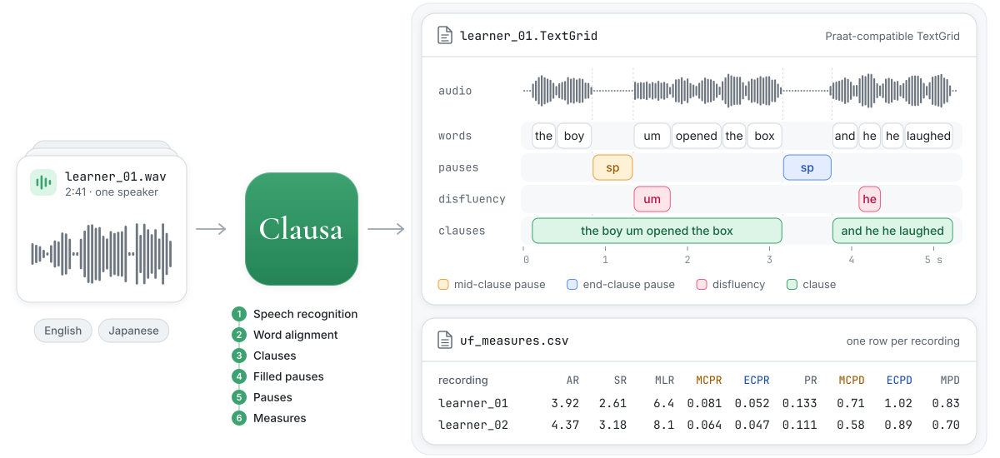

# Clausa

[English](README.md) · [日本語](README.ja.md) · 简体中文

Clausa 自动完成 utterance fluency 研究中的标注工作。输入口语录音，它会把标注输出为 TextGrid 文件（words、pauses、disfluencies、clauses）。它支持英语和日语，适用于第二语言和第一语言口语。

Clausa 是研究工具，目的只有一个：尽可能准确地标注口语录音，让研究者能据此计算 utterance fluency 指标。

<picture>
  <source media="(prefers-color-scheme: dark)" srcset="docs/images/overview-dark.svg">
  
</picture>

名称来自 *clause* 和 *pausa*（拉丁语的 pause）。

## 下载

- Mac：[Clausa-1.0.4-macos-arm64.zip](https://github.com/0ldriku/Clausa/releases/download/v1.0.4/Clausa-1.0.4-macos-arm64.zip)
- Windows：[Clausa-1.0.4-windows-x64.zip](https://github.com/0ldriku/Clausa/releases/download/v1.0.4/Clausa-1.0.4-windows-x64.zip)
- Linux：[命令行](docs/command-line.md)（英文）

[各版本的变更](CHANGELOG.md)（英文）

## 系统要求

| | Mac | Windows |
|---|---|---|
| 系统 | Apple 芯片，macOS 14 或更高版本 | 64 位 Windows 11，或装有 Microsoft Edge 的 Windows 10 |
| 显卡 | 内置 | NVIDIA，显存 8 GB 或以上；可选，没有显卡时约慢 3 倍 |
| 内存 | 16 GB 或以上 | 16 GB 或以上；没有 NVIDIA 显卡时 32 GB |
| 可用空间 | 20 GB | 30 GB |
| 网络 | 首次启动时需要，下载 8.3 GB | 首次启动时需要，下载 11.8 GB |

一切都在你的电脑上运行：Clausa 不收集也不发送任何内容，只在首次启动时联网下载模型。

## 安装

**Mac**

1. 解压下载的文件，把 `Clausa` 文件夹移到个人文件夹。
2. 双击 **First start**。如果 macOS 阻止它运行，打开系统设置 › 隐私与安全性，点击**仍要打开**。
3. 等窗口显示 Ready，然后点击 **Open Clausa**。

之后，打开 **Clausa.app** 即可。

**Windows**

1. 右键单击 zip 文件，选择**全部提取**。
2. 双击 `Clausa` 文件夹中的 **Clausa.exe**。如果 Windows 显示“Windows
   已保护你的电脑”，点击**更多信息**，再点击**仍要运行**。
3. 等窗口显示 Ready，然后点击 **Open Clausa**。

之后，打开 **Clausa.exe** 即可。

`Clausa` 文件夹不要放在 iCloud 云盘、OneDrive 或 Dropbox 中。如果安装中断，再启动一次即可：它会从中断处继续。

## 使用

1. 点击**新建项目**。为项目命名，并选择英语或日语。
2. 在**标注**中点击**添加录音**，或把音频文件（WAV、MP3、FLAC、OGG 或 M4A）拖到窗口上，然后点击**开始**。
3. 在 Praat 中检查并修改 TextGrid。录音所在行的文件夹按钮会打开该轮分析的文件夹，TextGrid 位于 `clauses` 中。
4. 在**计算**中点击**开始**。点击**显示 CSV › 指标**，在文件夹中显示 `uf_measures.csv`。

项目保存在“文稿”文件夹（Windows 上为“文档”）中的 `Clausa projects` 里；可在**设置** › **更改文件夹…**中改为其他文件夹。

## 指标

| 指标 | 含义 |
|---|---|
| AR | 发声时间内每秒的 syllable 数 |
| SR | 每秒的 syllable 数，含 pause |
| MLR | 两次 pause 之间的 syllable 数 |
| MCPR | 每 syllable 的 clause 内 pause 数 |
| ECPR | 每 syllable 的 clause 末 pause 数 |
| PR | 每 syllable 的 pause 总数 |
| MCPD | clause 内 pause 的平均时长，单位为秒 |
| ECPD | clause 末 pause 的平均时长，单位为秒 |
| MPD | 全部 pause 的平均时长，单位为秒 |

[计算方法](docs/measures.md)（英文）。

## 准确性

与文章所用的版本相比，Clausa 已有改进。[详情](docs/improvements.md)（英文）。

要精确得到文章的结果，请参阅[复现论文](docs/reproducing-the-paper.md)（英文）。

## 局限性

Clausa 的结果由程序自动生成，可能有错误。报告之前请先检查，例如在 Praat 中打开标注文件。你对自己报告的结果负责。

## 速度

在我们的三台电脑上测得。一个录音是一段 2-3 分钟的音频文件。十个录音是十段各 49 秒到 4 分钟的音频文件，总计约 20 分钟。

| 电脑 | 一个录音 | 十个录音 |
|---|---|---|
| Mac：M1 Max，64 GB | 1 分钟 | 3 分钟 |
| Windows：Ryzen 5 3600，32 GB，RTX 4060 Ti 8 GB | 1.5 分钟 | 5 分钟 |
| Windows，不使用显卡 | 4.5 分钟 | |
| Linux：Ryzen 9 9950X，128 GB，RTX 5090，命令行 | 35 秒 | 1.5 分钟 |

## 常见问题

### Clausa 输出什么？

每个录音的 TextGrid 文件，给出每个单词、pause、disfluency 和 clause 的起止时间。这是主要输出。

在**计算**中，Clausa 根据 TextGrid 计算九项[指标](#指标)，写入 `uf_measures.csv`，并把指标所依据的单词、pause 和 clause 写入 `uf_words.csv`、`uf_pauses.csv` 和 `uf_clauses.csv`（[各列说明](docs/measures.md#tables)）。其他指标请根据这些表格或 TextGrid 文件自行计算，TextGrid 文件位于每轮分析的 `clauses` 文件夹中。

### 能分析对话或访谈吗？

可以。Clausa 会转写并标注全部语音，但不区分说话人。有多位说话人时，指标会混合所有人的语音：请只分析一个人说话的部分（[录音的一部分](#能只分析录音的一部分吗)），或改用 TextGrid 文件。区分说话人（说话人分离）比较复杂：除了识别说话人，指标还需要处理对方话轮的规则。今后的项目中可能会加入。

### 什么算作 pause？

单词之间 0.25 秒及以上的静音。

### 什么算作 clause？

按照 Vercellotti 和 Hall（2024，[doi:10.1016/j.rmal.2024.100132](https://doi.org/10.1016/j.rmal.2024.100132)）的定义，clause 是一个动词加上一个成分：包括限定 clause、各自带有补语或附加语的并列动词、带有显性成分的非限定 clause，以及没有系动词的谓语。在日语中，带有「から」「けど」「ので」等接续助词的谓语单独构成一个 clause，clause 在接续助词处结束；て形动词只有带有自己的补语或附加语时才构成 clause。两种语言的规则见论文（[引用](#引用)）。

### 什么算作 disfluency？

即 Clausa 的 disfluency 检测器标记的词：filled pause（um、えっと）、repetition、self-correction、false start 和 partial word；在日语中还包括 particle correction 和词读音的 false start。它不区分每个词属于哪一类。其局限：

- 它用英语会话（Switchboard）以及按规则从书面文本生成的学习者合成句（采用 Kundu et al., 2022 的方法）训练（[训练代码](training/disfluency_detector/)）。
- 它没有在真实的第二语言语音上测试过。在英语母语者的语音（DisfluencySpeech）上，它找出了 62% 的 disfluent 词，它标记的词中有 88% 确实是 disfluent（F1 .73）。日语只在合成句上测试过。
- 合成句针对以日语为母语的英语学习者和以英语为母语的日语学习者；其他母语的学习者可能有差异。

请在 Praat 中检查 disfluency tier。详情和文献见[模型卡](https://huggingface.co/oldriku/Clausa)（英文）。

### Clausa 在哪些语音上测试过？

第二语言学习者讲故事的独白，与人工标注比较（[准确性](#准确性)）：ALLSSTAR 的 40 个英语录音（36 人，14 种母语）和 I-JAS 的 40 个日语录音（20 人，4 个母语组），时长 19 秒到 6 分钟。其他语音也能处理，但没有评估过：第一语言语音、对话、儿童语音、其他任务、噪声大的录音。依赖这些指标之前，请先在 Praat 中检查一部分自己的录音。

### 录音最长可以多长？

在搭载 Apple 芯片的 Mac 上，测试过长达 80 分钟的录音，可以正常处理。在配备 8 GB NVIDIA 显卡的 Windows 电脑上，超过约 6 分钟的录音会变得非常慢（一段 10 分钟的录音用了 20 多分钟），请切成不到 6 分钟的几段。Linux 和更大的显卡没有用长录音测试过。

### 能只分析录音的一部分吗？

可以。在**标注**中选择一个新录音，在**分析范围**下选择**部分**：在波形上拖动两端或输入时间，并用**播放该范围**检查。范围以外的单词不计入 Clause TextGrid 和指标（单词 TextGrid 保留全部单词）。录音标注后，范围即被锁定；要分析其他范围，请将录音从项目中移除后重新添加。同一范围可以用于所有新录音；也可以通过项目 **···** 菜单中的**从 CSV 导入范围**，从 CSV（`file_id,start,end`，单位为秒）为每个录音分别设置。在命令行中：`--window 12.5 140`，或用 `--windows` 指定这样的 CSV（[命令行](docs/command-line.md)，英文）。

### 修改 TextGrid 后，如何重新计算指标？

在 Praat 中将其另存为文本文件，保存在原来的位置，不要更改各 tier 的名称。然后在**计算**中点击**开始**。未修改的 TextGrid 会得到与之前相同的指标。

命令行：`./clausa measures en <输出文件夹>`（[命令行](docs/command-line.md)，英文）。

### 为什么在另一台电脑上结果不同？

不同的电脑可能给出略有差异的转写。一项研究的所有录音请在同一台电脑上分析。

### 能只安装英语或只安装日语的部分吗？

目前不能。Clausa 安装的大部分内容（语音识别、对齐和 disfluency 检测的模型，以及运行它们的软件）由两种语言共用。只用于一种语言的部分很小：日语约 1.6 GB，英语约 0.6 GB。

## 语言

Clausa 支持英语和日语。它的设计不限于这两种语言，但每一步都有专为它们编写的部分。增加一种新语言，需要支持该语言的语音识别器和对齐器、为它编写的 clause 规则，以及统计它的 syllable 的方法。第一步之后的所有步骤都建立在转写文本之上，所以识别器对学习者语音的准确率最为关键。Disfluency 检测器更难扩展：它只用英语和日语训练过。

我们计划让 clause 切分更容易适配新语言。

## 帮助

我们只在自己的几台电脑上测试过 Clausa。如果它在你的电脑上无法运行，或出了别的问题，请在 [GitHub](https://github.com/0ldriku/Clausa/issues) 上提交 issue，或发邮件到 oldriku@proton.me。请附上 `Clausa` 文件夹中的 `logs` 文件夹。日志包含录音中识别出的单词，请确认可以分享后再发送。

## 面向程序员

- [命令行](docs/command-line.md)（英文）
- [复现论文](docs/reproducing-the-paper.md)（英文）
- [开发者指南](docs/development.md)（英文）

## 许可证

代码采用 MIT 许可证。Clausa 的 disfluency 检测器（[oldriku/Clausa](https://huggingface.co/oldriku/Clausa)）采用 CC BY-NC-SA 4.0，仅限非商业用途。详见 [LICENSE.md](LICENSE.md)。

## 引用

如果你使用 Clausa，请引用这篇文章。文章已被录用，即将发表；年份、卷、页码和 DOI 将在正式发表后补充。

> Lu, J., & Sato, R. (in press). Automatic cross-lingual annotation of
> clause-based utterance fluency in L2 speech. *Research Methods in Applied
> Linguistics*.

```bibtex
@article{lu_sato_clausa,
  author  = {Lu, Jialiang and Sato, Reiko},
  title   = {Automatic cross-lingual annotation of clause-based utterance fluency in {L2} speech},
  journal = {Research Methods in Applied Linguistics},
  year    = {in press}
}
```
